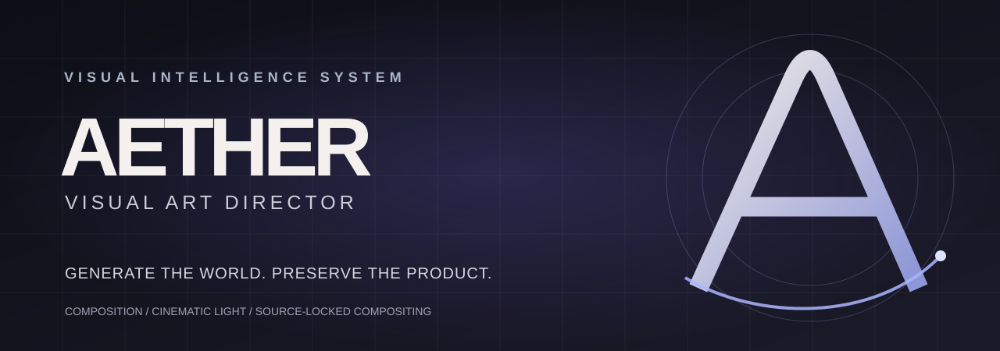

  

<h1 align="center">AETHER — VISUAL ART DIRECTOR</h1>

<strong>Generate the world. Preserve the product.</strong>

Premium reklam görselleri, yaratıcı ürün konseptleri ve kaynak fotoğrafını koruyan compositing için bir AI art direction skill'i.

  <a href="docs/install-chatgpt.md">ChatGPT Kurulumu</a> ·
  <a href="docs/install-codex.md">Codex Kurulumu</a> ·
  <a href="docs/quick-brief.md">Kısa Briefing</a> ·
  <a href="references/visual-production.md">Production Guide</a>

---

## AETHER nedir?

**AETHER**, ürün görselleri ve marka brieflerinden **az metinli, güçlü negatif alanlı, sofistike kompozisyonlar** tasarlamak için hazırlanmış görsel odaklı bir skill'dir. Bir görüntü üretim modeli değildir. ChatGPT/Codex'in erişebildiği görüntü üretim aracını yaratıcı biçimde yönlendirir; katmanlı kaynak-korumalı kompozit, tipografi, export ve QA için Python araçları sunar.

**Ana fikir:** Orijinal ürün fotoğrafının gerçek tasarımını değiştirmeden onun etrafında özgün bir dünya oluşturmak. Farklı çekim açısı gerekiyorsa ürün modelini hayal ederek tekrar çizmek yerine, kaynak fotoğrafla uyumlu bir mimari veya fotoğrafik sahne seçmek.

## Kullanım alanları

| İş | AETHER'ın yaklaşımı |
|---|---|
| Premium ürün reklamı | Bir güçlü görsel konsept, az copy, net hiyerarşi |
| Interior placement | Ürün fotoğrafıyla kamera/perspektif uyumlu yaşam alanı |
| Sculptural / surreal ad | Ürüne dayanan yaratıcı metafor ve kontrollü ortam |
| Instagram post / cover | 1:1, 4:5 ve gerektiğinde 9:16'ya art-directed adaptasyon |
| Ürün kimliğinin korunması | Kaynak RGB'sini ve logo/ekran/ayak/çerçeve detaylarını koruyan kompozit |
| Çoklu konsept | 3 yaratıcı yön ve kanıtlı Concept Evaluation |
| Marka kampanya serileri | Brand Visual DNA ve tutarlı, fakat tekrarsız görsel dil |

## Modüller

1. **Cinematic Photography Director** — Lens karakteri, kamera perspektifi, ışık ve gerçekçi materyal.
2. **Creative Concept Engine** — Özgün görsel metaforlar ve kampanya dünyaları.
3. **Advanced Product Fidelity** — Source-lock, mask, ölçek, yansıma ve fiziksel inandırıcılık.
4. **Advanced Layout & Typography** — Editorial grid, negatif alan, gerçek font, metin kontrolü.
5. **Brand Visual DNA** — Markaya uygun tekrar kullanılabilir tasarım ilkeleri.
6. **Visual Iteration & Retouching** — Katman bazlı kusur analizi ve hedefli düzeltmeler.

Ek altyapı: **Visual Reference Mining**, **Concept Evaluation**, **Product Scene Compositing**, **Instagram Safe Zones** ve teslim öncesi **Quality Checklist**.

## Hızlı kurulum

### ChatGPT

[ChatGPT kurulum rehberi](docs/install-chatgpt.md)

Skills yükleme özelliği varsa, bu depoyu SKILL.md kök dizinde kalacak şekilde ZIP olarak paketleyip **Plugins → Skills** bölümünden yükleyin. Özellik hesabınızda bulunmuyorsa ZIP'i bir sohbete yükleyip SKILL.md talimatlarını bu görev için uygulamasını isteyebilirsiniz. Bu geçici yöntem kalıcı Skill kurulumu değildir.

### Codex

[Codex kurulum rehberi](docs/install-codex.md)

macOS/Linux:

~~~bash
mkdir -p ~/.agents/skills
git clone https://github.com/Emirhanklby/AETHER-VISUAL-ART-DIRECTOR.git ~/.agents/skills/aether-visual-art-director
~~~

Windows PowerShell:

~~~powershell
New-Item -ItemType Directory -Force "$HOME/.agents/skills" | Out-Null
git clone https://github.com/Emirhanklby/AETHER-VISUAL-ART-DIRECTOR.git "$HOME/.agents/skills/aether-visual-art-director"
~~~

## Python production helpers

~~~bash
python -m pip install -r requirements.txt
python scripts/aether_visual.py --help
python scripts/aether_visual.py evaluate --input examples/concepts.json
~~~

Supporting commands:
- inspect — Dimensions, mode, alpha bounding box and source SHA-256.
- cutout — Apply a grayscale mask while preserving original product RGB.
- segment — Optional approximate OpenCV GrabCut segmentation; review required.
- composite — Scene plate + locked product + separated shadow/occlusion layers.
- typeset — Render approved copy with a supplied real font file.
- export — Exact-pixel PNG contain/cover and profile grid crop previews.
- audit — Dimensions and declared critical-content safe-zone boxes.
- evaluate — Evidence-based weighted comparison of creative directions.

~~~bash
python -m pip install -r requirements-dev.txt
python -m pytest -q
~~~

## Örnek istek

> AETHER kullanarak ekteki TCL televizyonun orijinal ürün fotoğrafı için 1080×1350 premium Instagram reklamı oluştur. Üç yaratıcı konsept geliştir ve Concept Evaluation uygula. Kaynak fotoğrafın ekran görseli, ayakları, çerçevesi ve logosunu aynen koru. Onun kamera açısına uyan ayrı, doğal ışıklı bir architectural living room sahnesi üret. Ürünü katmanlı kompozit olarak yerleştir, tek bir kısa başlık kullan, 60px ve profil kırpma güvenli alanlarını kontrol et.

## Proje yapısı

~~~text
SKILL.md                 Main reusable skill instructions
references/              Photography, compositing, research, typography, QA
scripts/aether_visual.py Python masking/compositing/export/evaluation tools
tests/                   Synthetic-asset unit tests
examples/                Sample concept scoring and brand brief
assets/                  AETHER SVG identity and repository cover
docs/                    ChatGPT, Codex, and concise creative brief
.github/workflows/       Python CI
AGENTS.md                Codex contributor guidance
~~~

## Güvenilirlik ve sınırlar

AETHER tek başına fotogerçekçi yeni görüntüler üretmez. Ortamdaki image generation araçlarını yönlendirebilir, ancak **otomatik maskeleme ve tam ürün korunumu kusursuz garanti edilemez**. Orijinal ürünün birebir piksel korunması yalnızca uygun kaynak, maske ve yeniden örnekleme yapılmadığı durumlarda mümkündür. Upscaling interpolation olabilir; bu AI super-resolution değildir.

Metin, marka renkleri, WCAG kontrastı, ürün fiziksel oranları ve görsel estetik otomatik QA sonucuyla kesin doğrulanmış sayılmaz; son dosya gözle incelenmelidir.

**Sürüm:** 2.0.1 · **Lisans:** Henüz seçilmedi. Üçüncü taraf marka materyalleri ve fotoğrafları varsayılan olarak serbest lisanslı değildir.
